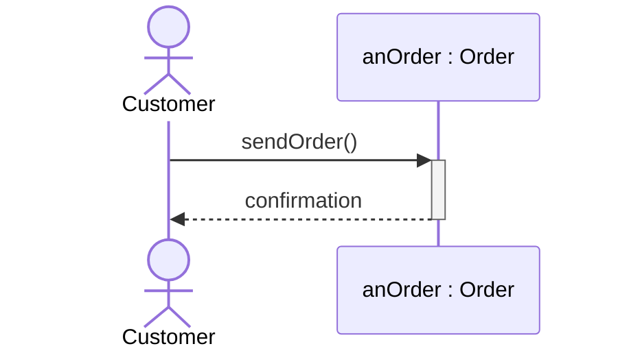

<p align="center"></p>

# umLoud

**Describe your system. Get a correct UML diagram back — not a guess at one.**

*Built with Claude. Available for any AI agent.*

umLoud turns a plain-English description, an existing diagram, or your actual code into a clear,
standards-compliant UML 2.5.1 diagram — as PlantUML, Mermaid, or both. Every example it ships with has been
render-checked, not just eyeballed, and the same discipline applies to what it generates for you.

Packaged as a Claude skill, but it's really just a plain-text instruction set (`SKILL.md`) — **any AI agent
that can follow written instructions and a file tree can run it**, not only Claude.

## What you can do with it

**Start from scratch.** Describe the system in a sentence or two and get back a properly modelled diagram —
right relationships, right notation, nothing invented. *"Draw a class diagram for a shopping cart with Cart,
CartItem and Product."*

**Generate from existing code.** Point it at a class, a module, or a whole file and it reads the code directly —
classes, inheritance, calls, associations — instead of making you redescribe what's already there.
*"Diagram the structure of OrderService.java."*

**Review and fix an existing diagram.** Paste one in and get back a list of what's wrong (UML 1 notation, bad
relationship directions, missing guards) with the rule it breaks, plus a corrected version.

**Explain a design, not just draw it.** Ask for a well-known pattern (Factory Method, Observer, Builder…) and
get a diagram built the way the pattern is actually meant to be modelled.

## Why it's correct, not just pretty

- **Targets the real, current standard** — UML 2.5.1 (OMG, Dec 2017), distilled from *UML Distilled* (3rd ed.)
  and updated for what's changed since.
- **No invented notation.** Relationship directions, arrowheads, and frame types follow the spec; anything
  non-standard is flagged as such rather than smuggled in.
- **Render-checked, on request.** It can run every diagram through an actual PlantUML/Mermaid renderer before
  calling it done, and send you back a preview image alongside the source — so "it renders" is a fact, not a
  hope.
- **Two Mermaid flavors.** A conservative profile that pastes straight into **Confluence's Mermaid macro** (even
  on older bundled Mermaid versions), and a modern profile with the full current feature set for GitHub, GitLab,
  Notion, Obsidian, and docs sites. It asks which one you need.

## Quickstart

**claude.ai / Claude Code** — upload `umloud-skill.zip` as a skill (or copy `skill/umloud/` to
`~/.claude/skills/umloud/` or `.claude/skills/umloud/`), then just ask for a diagram.
**Codex** — unzip `umloud-skill.zip` and copy the `umloud/` folder into `.codex/skills/`.
**Any other agent** — hand it `skill/umloud/SKILL.md` as its instructions.

Invoke it with `/umloud`, then try one of:
```
/umloud create a class diagram for a shopping cart
/umloud diagram the structure of OrderService.java
/umloud draw a sequence diagram for user login with 2FA
/umloud review this state machine diagram for correctness: [paste]
```
It will ask once which output format you want (PlantUML, Mermaid, or both — and, for Mermaid, whether it's
headed to Confluence) before drawing anything.

## Example output


*(a minimal slice — real output includes the full scenario, frames, and a rendered preview on request)*

---

## For developers & agents

> Entry point is `skill/umloud/SKILL.md`. Load files on demand only. Update this README on every file/folder change.

### Structure

```text
umLoud/
├── README.md                 this file
├── LICENSE                   MIT
├── umloud-skill.zip          packaged skill/umloud/ for upload (rebuild after edits)
├── docs/                     header image for this README
├── .gitignore                zip, __pycache__, evals/results
└── skill/umloud/
    ├── SKILL.md              workflow: ask format (+ Confluence?) → pick diagram → load only needed files → draw → deliver → ask to validate (opt-in)
    ├── references/           RULES (format-neutral)
    │   ├── 00-choosing-a-diagram.md   which diagram for which question; modes; perspectives
    │   ├── 01-general-principles.md   naming, suppression, size limits, notes (first diagram per conversation)
    │   ├── <type>.md                  class, object, package, sequence, communication, use-case,
    │   │                              state-machine, activity, component, deployment, other-diagrams
    │   ├── review-checklist.md        final QA
    │   ├── mda-executable-uml.md      MDA & Executable UML (only when asked)
    │   ├── uml-versions.md            changes since the book, UML 1→2 (only when needed)
    │   └── syntax/            SYNTAX + tested examples, one folder per format
    │       ├── plantuml/  _common.md + <type>.md
    │       └── mermaid/   _common.md (capabilities, Confluence profile) + _modern.md (non-Confluence extras) + <type>.md
    ├── evals/                evals.json (8 cases: explicit, implicit, Confluence, review, negatives) + files/shop/models.py fixture
    ├── assets/
    │   └── templates/        starter skeletons: plantuml/*.puml, mermaid/*.mmd
    └── scripts/validate.py   optional render check (only with user consent); output goes to a temp dir; --confluence warns on unsafe Mermaid
```

### Token budget
Rules and syntax are split so a request loads only the diagram type and format it needs
(class diagram, one format, incl. SKILL.md and review checklist: ~8k tokens). Don't merge them back.

### Validate
Validation is **optional and permission-based**: after delivering a diagram the skill offers a render check and
runs `scripts/validate.py` only if the user says yes. Nothing is saved to the user's folders — the diagram source
is pasted in chat, and any render output goes to a temp directory (override with `--out`).

Options: `<files>`, `--format png|svg`, `--out DIR`, `--plantuml-jar JAR`, `--chrome PATH`, `--confluence`.
Exit codes: 0 all rendered, 1 a diagram failed, 2 a tool is missing. PlantUML needs Java and the jar;
Mermaid needs Mermaid CLI (`mmdc`) plus a Chrome/Chromium binary for Puppeteer — point to it with `--chrome`
if it isn't found. A missing tool is a setup gap, not a diagram problem.
All 56 examples/templates pass (PlantUML 1.2024.7, Mermaid CLI 11).

### Maintaining
- Rules → `references/`, syntax/examples → `references/syntax/<format>/`. Keep both formats' files for a type in sync.
- Re-run `validate.py` after edits; rebuild the zip; update the tree above and the changelog.
- `umloud-skill.zip` is a build artifact — gitignore it rather than committing; attach it to a release instead
  if you want a versioned download.

### Changelog
- **2026-10-27** — Folders reorganised (`references/syntax/`, `assets/templates/`); SKILL.md frontmatter (version, tags, allowed-tools) and sections added; 10 worked examples; validation made optional and consent-based with temp-only output; `validate.py` hardened (`shell=False`, timeouts, allow-listed formats); `evals/` added; PlantUML sequence `autoactivate` + alt/else example fixed; 56 diagrams re-verified.
- **2026-10-25** — Initial version: SKILL.md, references, templates, validate.py; all examples render-tested.

## Contributing

Issues and PRs welcome — see [`CONTRIBUTORS.md`](CONTRIBUTORS.md) for who's already helped out.

- **Bug / incorrect notation?** Open an issue with the request you gave it and what came back.
- **Adding or editing a diagram type or syntax rule?** Rules live in `skill/umloud/references/` (format-neutral),
  syntax + examples in `skill/umloud/references/syntax/<format>/`. Keep PlantUML and Mermaid in sync for the same type.
- **Before opening a PR:**
  1. Make sure every example still renders.
  2. Rebuild `umloud-skill.zip` from `skill/umloud/`.
  3. Update the structure tree and changelog in this README.
- Keep `SKILL.md` lean — it's loaded on every run. Put detail in `references/` (including `references/syntax/`) and load it on demand.

## License

MIT — see [`LICENSE`](LICENSE). Use it, fork it, modify it, ship it.