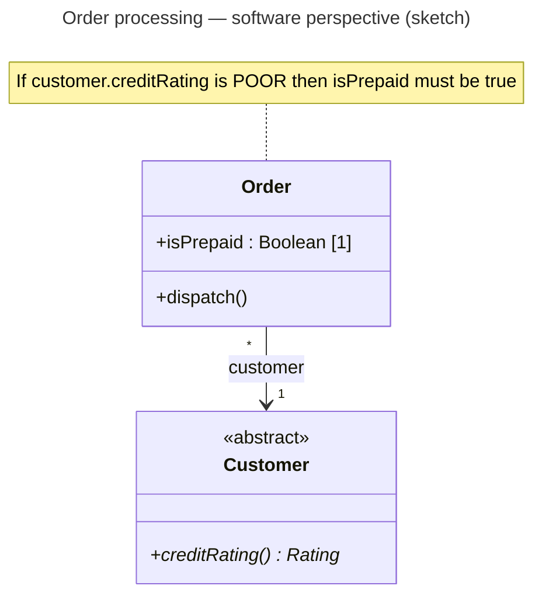
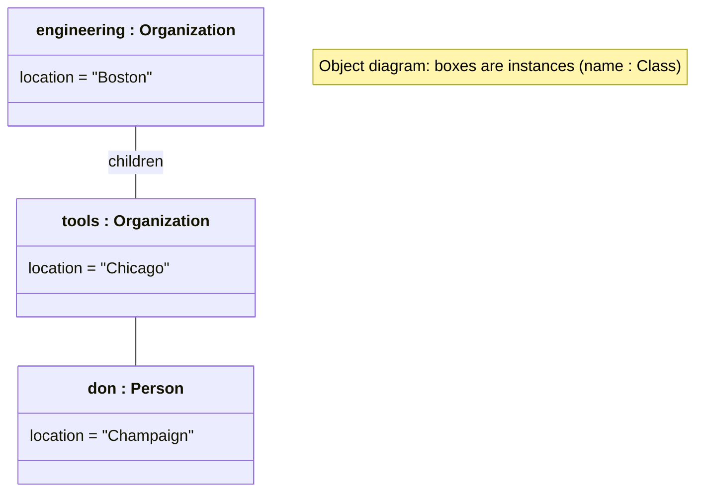
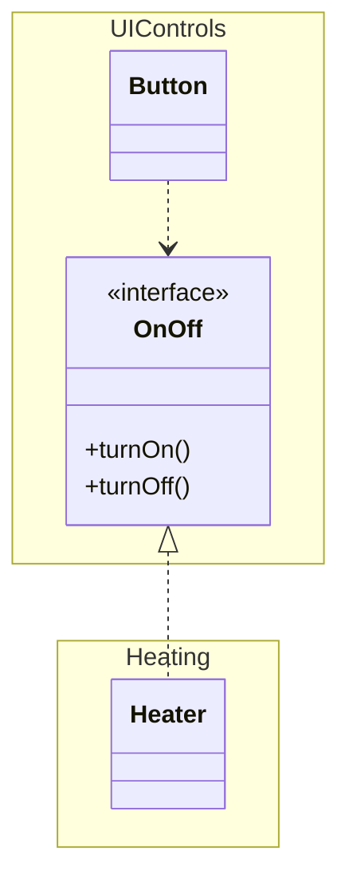
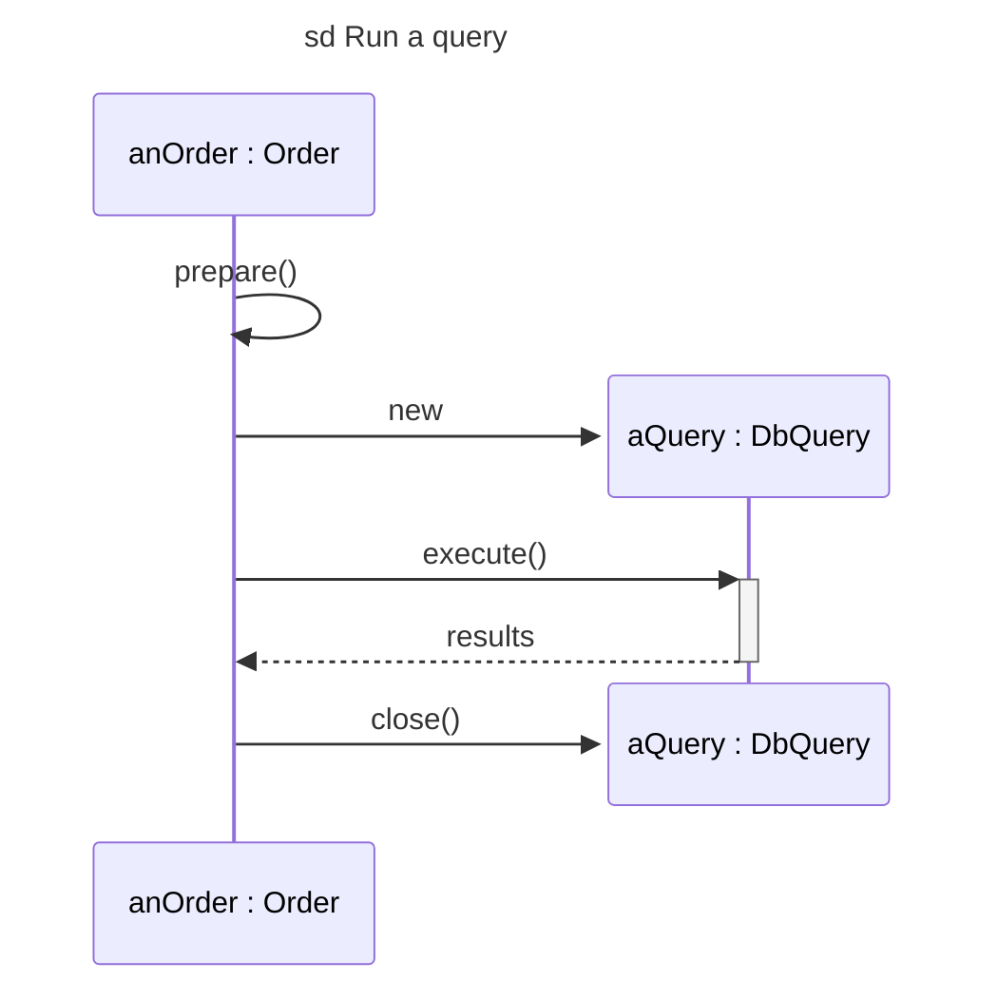

# Mermaid — modern profile (not for Confluence)

Load only when the user wants Mermaid **not** for Confluence (GitHub, GitLab, Notion, Obsidian, docs sites, current Mermaid Live).
Start from the type's syntax file (Confluence-safe, works everywhere), then use these newer features where they help.
Deliver as a fenced ```` ```mermaid ```` block so Markdown hosts render it.

| Feature | Use for |
|---|---|
| Front-matter `---` / `title: …` / `---` before the diagram type | Real diagram title (instead of a `%%` comment) |
| `direction LR` / `TB` inside `classDiagram` and `stateDiagram-v2` | Better layout |
| `note for Class "…"` in class diagrams | Constraints and notes attached to a class |
| `class id["label"]` | Object diagrams (`name : Class` boxes with slots) |
| `namespace Name { … }` in class diagrams | Packages that show their classes |
| `create participant X` / `destroy X` in sequence diagrams | UML creation and deletion |

## Class diagram with title, direction and note



## Object diagram with labelled instance boxes



## Packages with their classes



## Sequence diagram with title, creation and deletion


