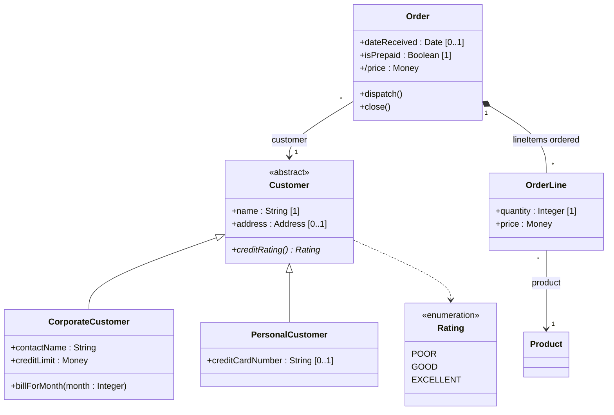

# Mermaid — Class diagrams

Rules live in `references/class.md`; this file is syntax only. Read `references/syntax/mermaid/_common.md` first.

Mermaid syntax: `<|--` generalization, `<|..` realization, `*--` composition, `o--` aggregation (avoid),
`-->` association, `..>` dependency; `<<interface>>`/`<<abstract>>`/`<<enumeration>>` as first line in the class;
method suffix `*` = abstract, `$` = static; generics `class Set~T~`.

**Mermaid limitations (say so when it matters):** no qualified associations; no true association class
(approximate with a dashed link `..` to the class plus a note); role name and multiplicity can't be
placed independently at each end (put the role name in the link label); no italics for abstract — use
`<<abstract>>`; no generalization sets; no `{constraint}` placement except via notes; braces in labels
can break parsing — write `ordered` instead of `{ordered}` in link labels.
