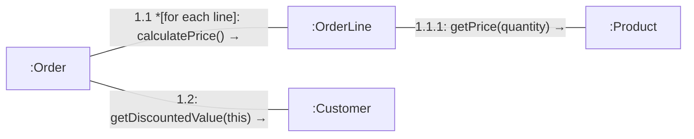

# Mermaid — Communication diagrams

Rules live in `references/communication.md`; this file is syntax only. Read `references/syntax/mermaid/_common.md` first.

**Limitations (both tools):** message arrows are written as text (`→`) on the link label, not drawn alongside the link.
