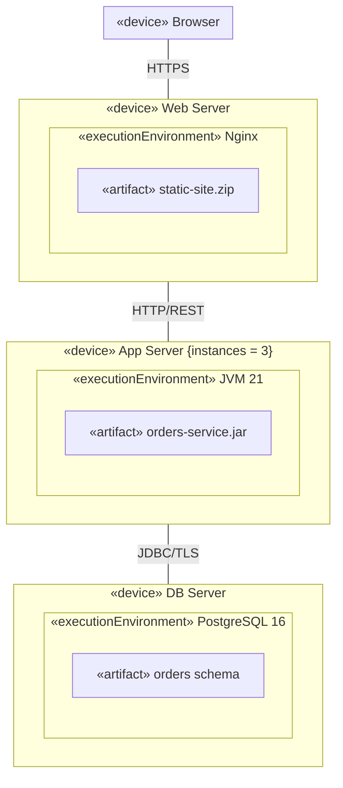

# Mermaid — Deployment diagrams

Rules live in `references/deployment.md`; this file is syntax only. Read `references/syntax/mermaid/_common.md` first.

Mermaid has no deployment diagram; use nested subgraphs (node ⟶ execution environment ⟶ artifact) and labelled undirected links.

**Mermaid limitations:** no 3-D node shape (keywords carry the meaning); links between subgraphs can render on odd sides;
for large deployments prefer PlantUML.
