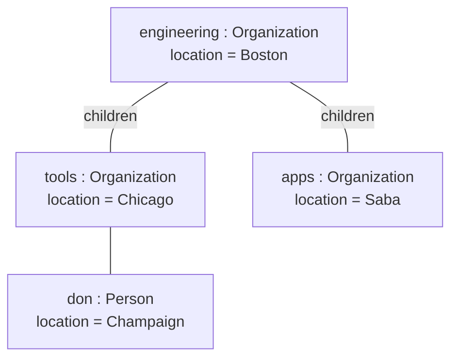

# Mermaid — Object diagrams

Rules live in `references/object.md`; this file is syntax only. Read `references/syntax/mermaid/_common.md` first.

Mermaid has no object diagram; use a flowchart with one box per instance (name can't be underlined — say the boxes are instances).

**Mermaid limitations:** no underline for instance names and no slot compartment (slots go on extra label lines).
