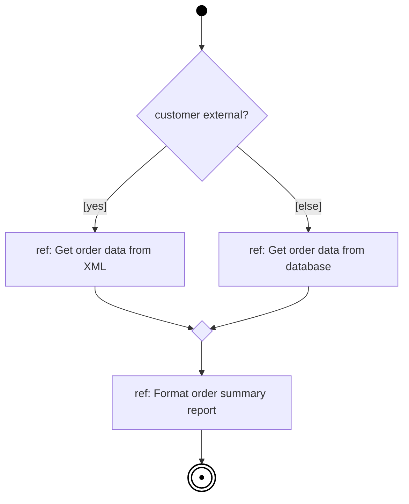
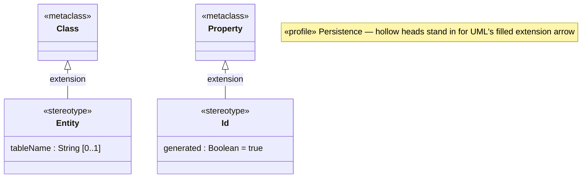

# Mermaid — less common diagrams

Rules live in `references/other-diagrams.md`. Read `references/syntax/mermaid/_common.md` first.

## Interaction overview diagrams (approximation)

## Timing diagrams

Mermaid has **no timing diagram**. Use PlantUML, or a table of events with timing constraints as a fallback, and state that limitation.

## Collaborations

No collaboration notation — annotate classes with a `<<pattern: role>>` line or a note instead.

## Profile diagrams (added in UML 2.2) (approximation)

