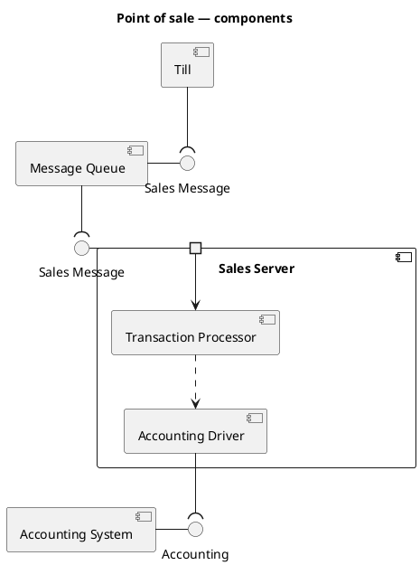

# PlantUML — Component and composite structure diagrams

Rules live in `references/component.md`; this file is syntax only.

PlantUML tips: `skinparam componentStyle uml2` gives the UML 2 rectangle + icon; `() "Name" as I` declares an interface;
`A - I` = A provides I (lollipop), `B --( I` = B requires I (socket); `port`, `portin`, `portout` for ports;
nest components in `component X { ... }` for composite structure.
