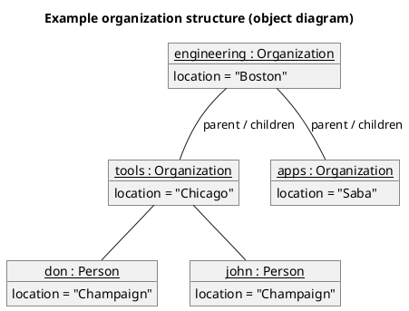

# PlantUML — Object diagrams

Rules live in `references/object.md`; this file is syntax only.

PlantUML tip: wrap the name in `<u>…</u>` to underline it as UML requires; `object "label" as id { slot = value }`.
