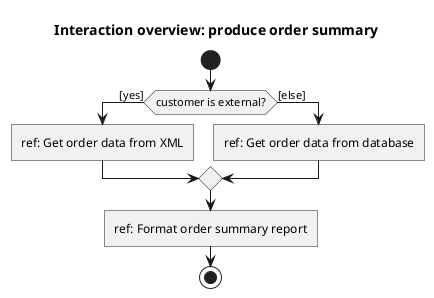
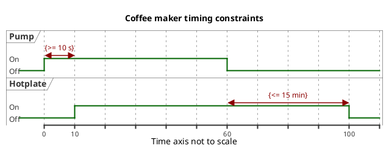
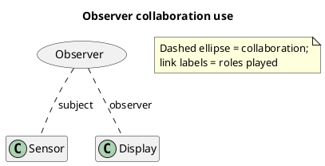
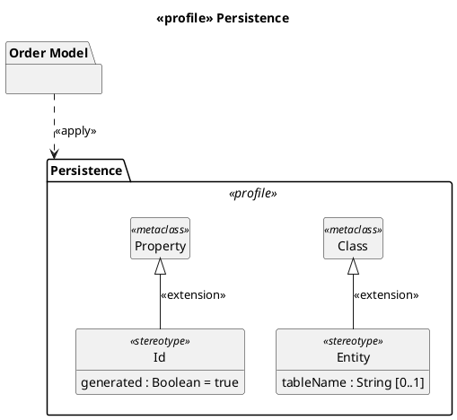

# PlantUML — less common diagrams

Rules live in `references/other-diagrams.md`.

## Interaction overview diagrams (approximation with an activity diagram)

## Timing diagrams

## Collaborations (not an official UML 2 diagram type) (approximation)

## Profile diagrams (added in UML 2.2)

PlantUML can't draw the **filled** extension triangle: it uses the hollow generalization head labelled `«extension»`
— state that in a note when precision matters.
