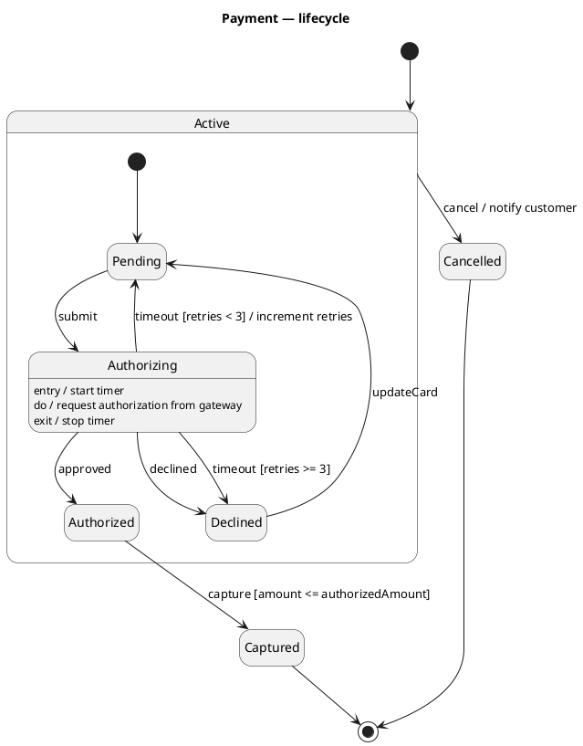
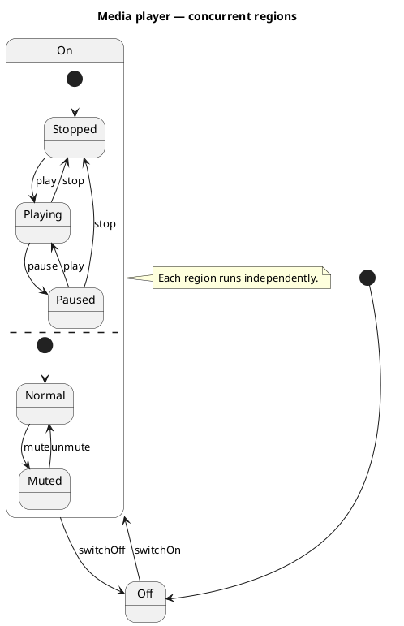
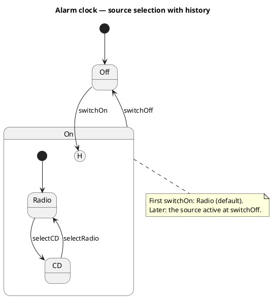

# PlantUML — State machine diagrams

Rules live in `references/state-machine.md`; this file is syntax only.

Orthogonal (concurrent) regions:

History pseudostate (resume the last substate on re-entry):

PlantUML tips: `[*]` initial/final; `state X : entry / ...` adds internal activity lines; `--` (or `||`)
separates concurrent regions inside a composite; `X[H]` / `X[H*]` are shallow/deep history; `<<choice>>`,
`<<fork>>`, `<<join>>` stereotypes on states give pseudostates; `hide empty description`.
Declare composite states before (or instead of) referencing their substates at top level, otherwise
PlantUML creates the substate outside the composite. Avoid history inside a state that also has `--`
regions (PlantUML drops the region separator); point the history at a single-region composite.
