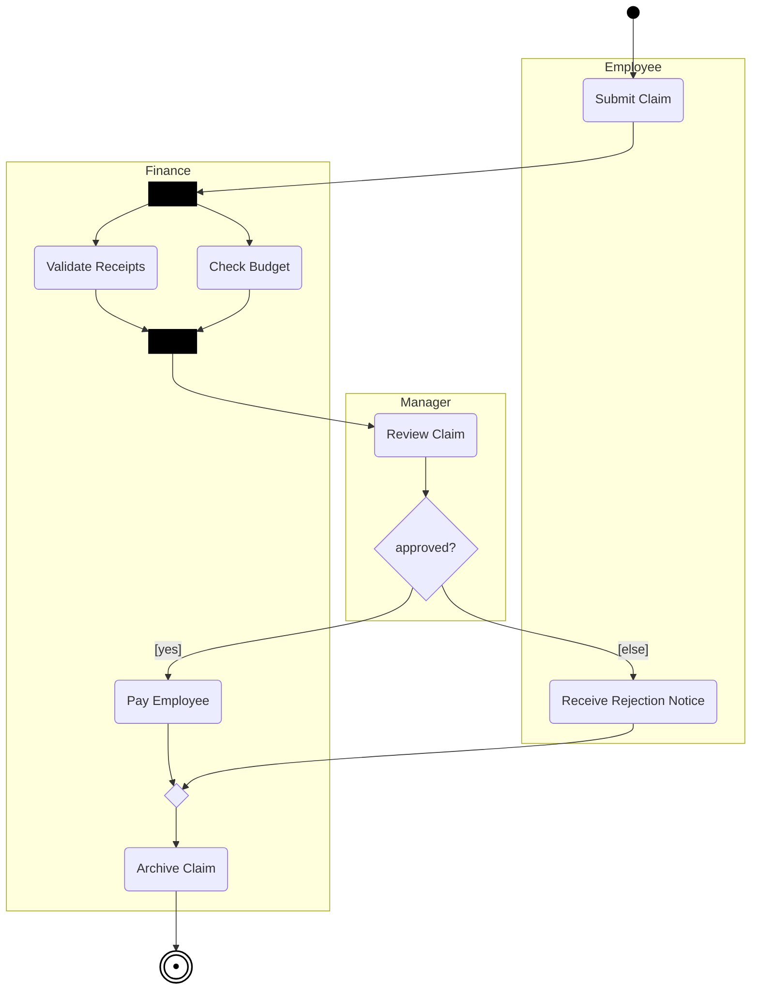

# Mermaid — Activity diagrams

Rules live in `references/activity.md`; this file is syntax only. Read `syntax/mermaid/_common.md` first.

Mermaid has **no UML activity diagram**; use this flowchart convention (and say so):
initial = small filled circle, final = double circle, actions = rounded boxes, decision/merge = diamonds,
fork/join = black bar node, partitions = subgraphs.

**Mermaid limitations:** fork/join bars, initial/final nodes and partitions are approximations of UML shapes;
subgraph "lanes" don't line up as true swim lanes; no signal, time-event, pin, expansion-region or flow-final
shapes (use a labelled node such as `⊗ flow final` or a note). For a strict UML activity diagram prefer PlantUML.
