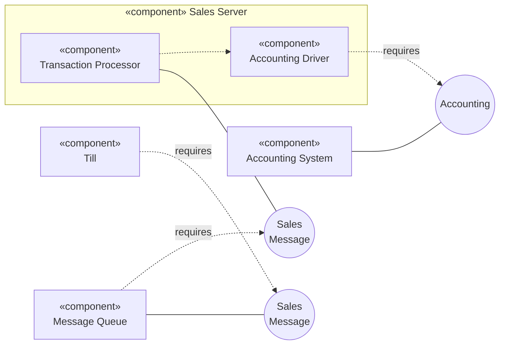

# Mermaid — Component and composite structure diagrams

Rules live in `references/component.md`; this file is syntax only. Read `syntax/mermaid/_common.md` first.

Mermaid has no UML component diagram. Approximate with a flowchart: components as boxes with «component»,
interfaces as small circles, provided = solid line, required = dashed line labelled "requires".

**Mermaid limitations:** no ball/socket or port shapes — add a legend ("○ = interface; solid = provides; dashed = requires");
for anything beyond a simple overview prefer PlantUML. (Mermaid's C4 and architecture diagrams are not UML.)
