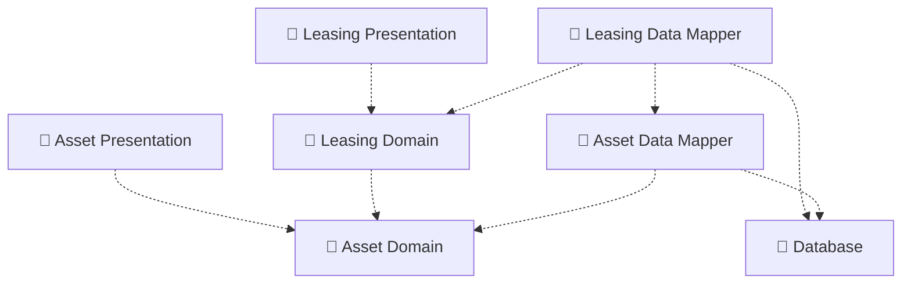
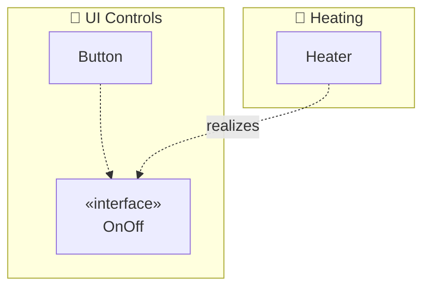

# Mermaid — Package diagrams

Rules live in `references/package.md`; this file is syntax only. Read `syntax/mermaid/_common.md` first.

Mermaid has no package diagram; use a flowchart with folder-labelled nodes and dashed dependency arrows.

For packages **with their classes**, use subgraphs as packages:

**Mermaid limitations:** no folder shape (use the 📁 label or a note); no `«import»`/`«merge»` semantics.
