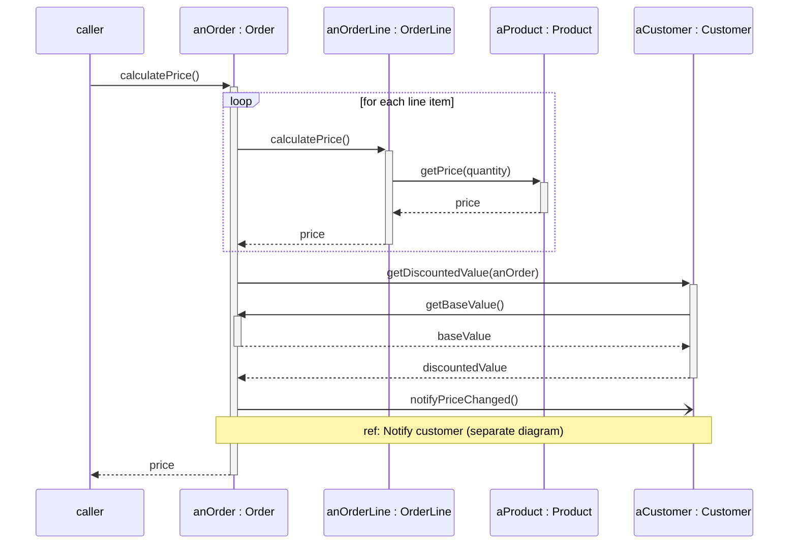

# Mermaid — Sequence diagrams

Rules live in `references/sequence.md`; this file is syntax only. Read `syntax/mermaid/_common.md` first.

Mermaid syntax: `->>` synchronous (filled head), `-)` asynchronous (open head), `-->>` return;
`+`/`-` after the arrow activate/deactivate; frames `loop`, `alt … else … end`, `opt`, `par … and … end`,
`critical … option … end`, `break`; `Note over A,B: text`.

**Mermaid limitations:** no found message (add a `caller` participant and say so); no `ref` frame (use a
note `ref: <name>`); no `neg` frame; `create participant` / `destroy` exist only in newer Mermaid
(v10.3+) — many Confluence Mermaid apps bundle older versions, so avoid them for Confluence or
check the app's version; nested activations on self-calls render, but less clearly than PlantUML.
