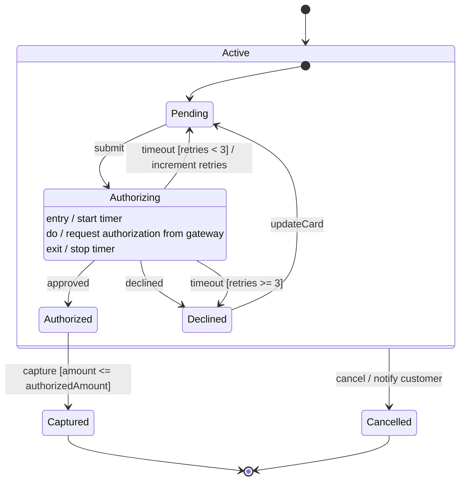
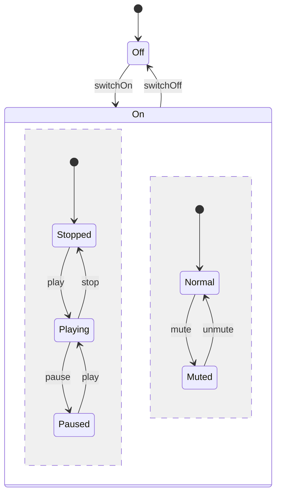

# Mermaid — State machine diagrams

Rules live in `references/state-machine.md`; this file is syntax only. Read `syntax/mermaid/_common.md` first.

Concurrent regions in Mermaid use `--` inside a composite state:

Mermaid syntax: `[*]` initial/final; `state Name { ... }` composite; `--` concurrent regions; `Name : text`
adds description lines (use for `entry /`, `exit /`, `do /`) — **declare `state "Name" as Name` first**, otherwise
the first description line replaces the state name; `state c <<choice>>`, `<<fork>>`, `<<join>>`;
`note right of State ... end note`.

**Mermaid limitations:** no history pseudostate (add a note "resumes last substate (H)"); transitions
out of a composite to an inner state of another composite can render poorly; description lines are
not visually separated into a compartment; guards with `{ }` may break parsing — use `[ ]` only.
