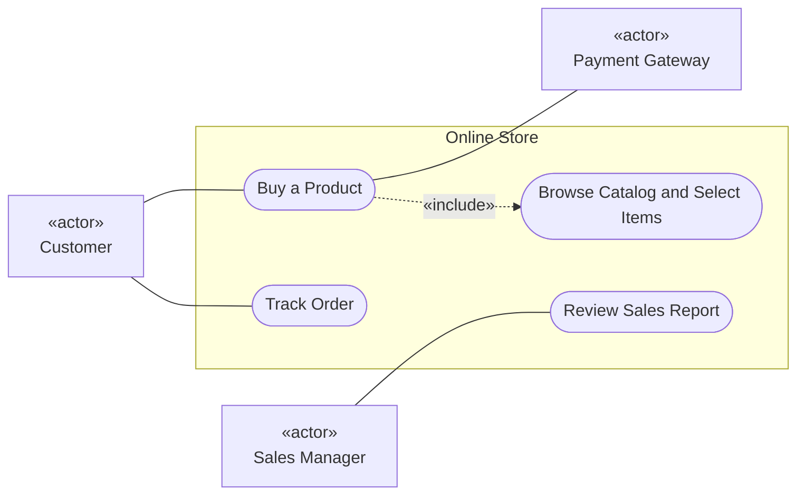

# Mermaid — Use cases (text first, diagram second)

Rules live in `references/use-case.md`; this file is syntax only. Read `syntax/mermaid/_common.md` first.

Mermaid has **no use-case diagram type**. Use this flowchart convention and say it is an approximation:
actors as plain boxes marked «actor», use cases as stadium shapes inside a subgraph (system boundary).

