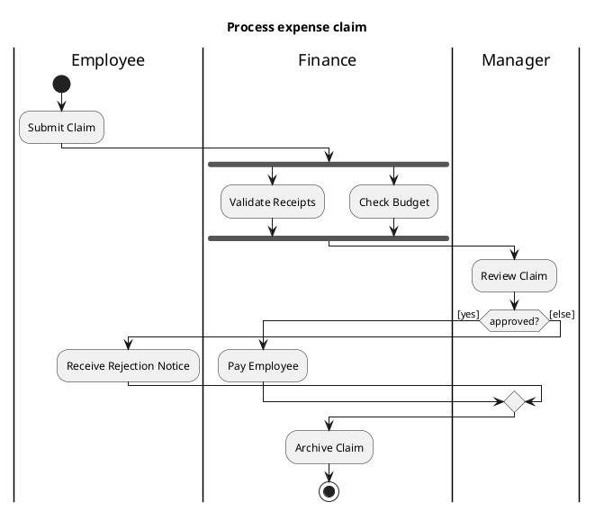
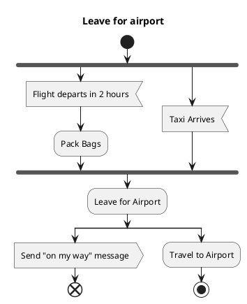

# PlantUML — Activity diagrams

Rules live in `references/activity.md`; this file is syntax only.

Signals, time events, flow final:

PlantUML tips: `start` / `stop` (activity final) / `end` (flow final ⊗); `:Action;`; `if (...) then ([guard]) ... else ([else]) ... endif`
draws decision + merge; `fork` / `fork again` / `end fork` (or `end merge`); `|Lane|` partitions;
`:Accept<` accept signal, `:Send>` send signal (no hourglass — put "after 2h" in the accept text or a note);
`split` for non-synchronised starts; expansion regions are not supported — use `partition "«concurrent» for each item" { }` + a note.
