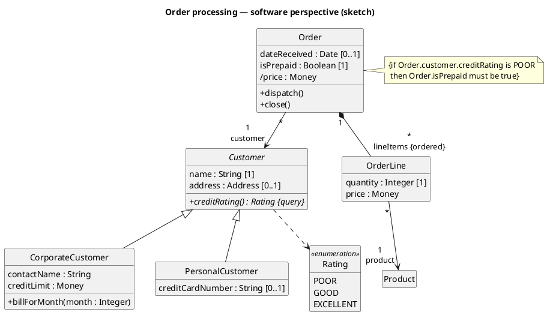
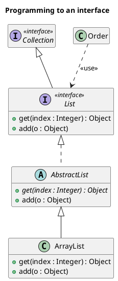
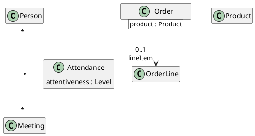

# PlantUML — Class diagrams

Rules live in `references/class.md`; this file is syntax only.

Interfaces, ball-and-socket and dependency keywords:

Association class and qualified association:

PlantUML tips: `hide empty members` removes empty compartments; `hide circle` removes PlantUML's
(non-UML) C/A/I/E icons for a standard look; `skinparam classAttributeIconSize 0`
shows `+ - # ~` as text instead of icons; `{static}` / `{abstract}` modifiers; `<|--` generalization,
`<|..` realization, `*--` composition, `o--` aggregation (avoid), `..>` dependency, `-->` navigable association.
Put multiplicity and role name together in the end label: `"1\ncustomer"`.
