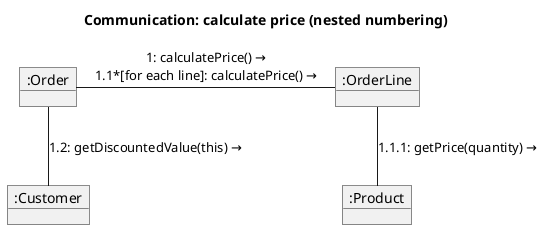

# PlantUML — Communication diagrams

Rules live in `references/communication.md`; this file is syntax only.

PlantUML has no native communication diagram; use an object-style layout with numbered link labels.

