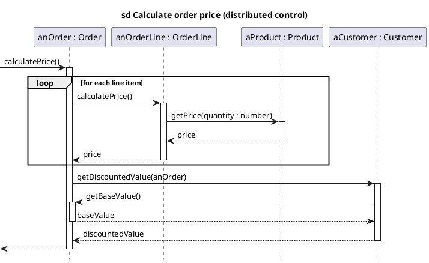
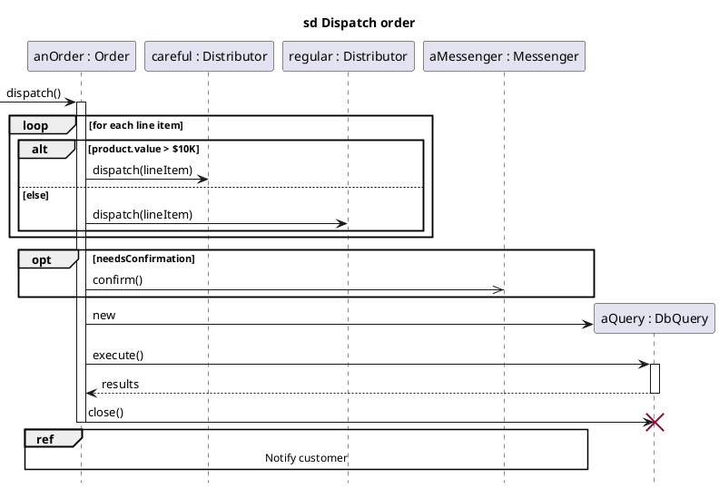

# PlantUML — Sequence diagrams

Rules live in `references/sequence.md`; this file is syntax only.

Creation, deletion, alt/opt, async and ref:

PlantUML tips: `->` synchronous (filled), `->>` asynchronous (open), `-->` return; `[->` found message,
`[<--` return to caller; `autoactivate on` + `return` keeps activations tidy; `hide footbox` removes the
repeated participant boxes at the bottom; `create participant`/`destroy`; `ref over A, B : name`.
